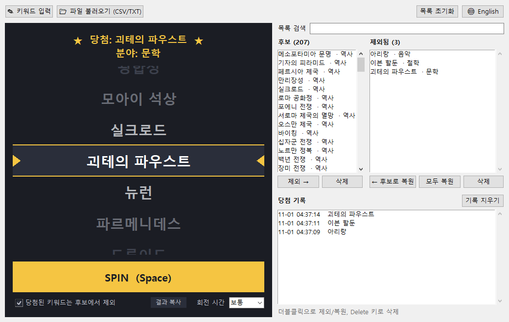
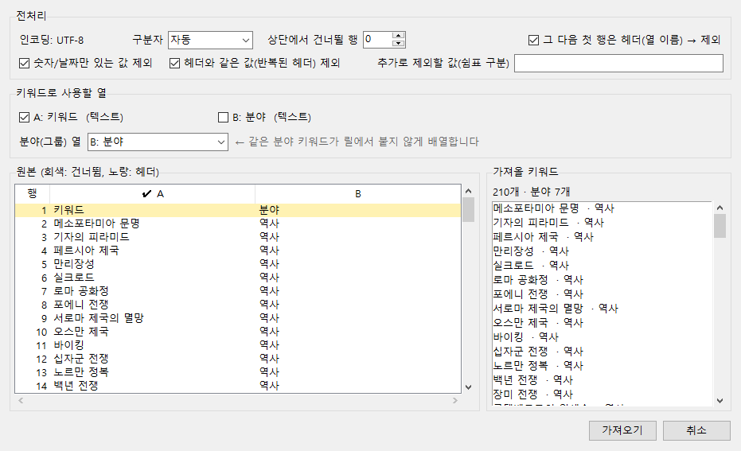

[English](README.md) | **한국어**

# CurioSpin (큐리오스핀)

호기심을 위한 슬롯머신입니다. 주제 목록을 넣고 **SPIN**을 누르면, 다음에 읽거나 공부하거나 이야기할 주제를 릴이 골라 줍니다.

CurioSpin은 설치가 필요 없는 포터블 Windows 실행 파일 하나입니다. AI 모델이나 온라인 서비스를 쓰지 않고, 모든 기능이 내 PC에서 알고리즘만으로 동작합니다.



## 만든 이유

**『1일 1페이지, 세상에서 가장 짧은 교양 수업 365』**(원서 *The Intellectual Devotional: Revive Your Mind, Complete Your Education, and Roam Confidently with the Cultured Class*)는 일곱 분야의 교양 주제를 하루 한 페이지씩 다루는 책입니다. 처음부터 순서대로 읽으니 숙제처럼 느껴져서, 그날 읽을 주제를 무작위로 고르고 싶었습니다. 쪽 번호 365개 중에서 주사위를 굴리는 건 재미가 없으니, 실제 주제 이름들이 돌아가다가 하나에 멈추는 슬롯머신을 만들었습니다.

> CurioSpin은 이 책이나 출판사와 관계가 없으며, 이 저장소에는 책의 내용이 전혀 들어 있지 않습니다. [샘플 키워드 목록](#샘플-키워드-목록)은 책의 주제를 피해서 따로 만들었습니다. 책과 함께 쓰려면 직접 목록을 만들어 넣으세요.

## 기능

- **슬롯머신 추첨**: 릴이 돌다가 점점 느려지고, 살짝 넘어갔다 돌아오며 당첨 키워드에 멈춥니다. 회전 시간은 짧게/보통/길게 중에서 고를 수 있습니다.
- **공정한 추첨**: 애니메이션이 시작되기 *전에* OS 난수로 모든 후보 중 하나를 같은 확률로 먼저 뽑습니다. 릴 순서는 당첨 확률에 영향을 주지 않습니다.
- **비슷한 주제는 붙지 않게**: 회전할 때마다 릴 순서를 새로 섞으면서 비슷한 키워드를 서로 떨어뜨립니다(예: *모차르트의 레퀴엠*과 *볼프강 아마데우스 모차르트*). 같은 분야 키워드도 떨어뜨립니다. 원리는 [동작 원리](doc/how-it-works.ko.md) 문서에 있습니다.
- **당첨 제외와 복원**: 당첨된 키워드를 자동으로 *제외됨* 목록으로 옮길 수 있습니다. 잘못 뺀 키워드는 클릭이나 더블클릭 한 번으로 되돌립니다.
- **키워드를 넣는 세 가지 방법**
  - **직접 입력**: 자동완성이 없는 일반 텍스트 칸입니다. 한 줄에 하나씩 쓰거나 쉼표로 구분합니다.
  - **TXT**: 한 줄에 하나씩 씁니다. `#`으로 시작하는 줄은 주석으로 보고 건너뜁니다.
  - **CSV 전처리**: 제목 행, 헤더 행, 키워드와 무관한 열(번호, 숫자, 날짜, 메모 등)을 자동으로 찾아 뺍니다. 가져오기 전에 미리보기에서 모든 설정을 확인하고 바꿀 수 있습니다.
- **분야 인식**: CSV에 분야/분류 열이 있으면 이를 이용해 릴에서 분야가 고르게 섞이게 합니다.
- **영어 / 한국어 화면**: 🌐 버튼으로 바꿉니다. 기본 언어는 영어입니다.
- **포터블**: 목록, 당첨 기록, 설정은 exe 옆의 `keyword_slot_data.json`에 저장됩니다.



## 설치

1. [Releases](../../releases) 페이지에서 `CurioSpin.exe`를 내려받습니다.
2. 아무 폴더에나 두고 더블클릭합니다. 설치 과정도, 따로 필요한 프로그램도 없습니다.

exe에 코드 서명이 없어서 처음 실행할 때 Windows SmartScreen이 "알 수 없는 게시자" 경고를 띄울 수 있습니다. **추가 정보 → 실행**을 누르면 됩니다.

### 소스에서 빌드하기

Windows, Tkinter가 포함된 Python 3.12 이상, 그리고 [uv](https://docs.astral.sh/uv/)(또는 일반 `pip`)가 필요합니다.

```bat
git clone https://github.com/hobby-programmer-5000/curio-spin.git
cd curio-spin
uv venv --python 3.14 .venv
uv pip install --python .venv\Scripts\python.exe pyinstaller
build.bat
```

`build.bat`는 테스트를 먼저 돌린 뒤 `dist\CurioSpin.exe`를 만듭니다. 빌드 없이 바로 실행하려면 `python app.py`를 쓰세요.

## 사용법

1. **키워드 추가**: **✎ 키워드 입력**으로 직접 쓰거나, **📂 파일 불러오기**로 CSV/TXT를 엽니다. [`samples/`](samples) 폴더의 파일로 바로 해 볼 수 있습니다.
2. **스핀**: **SPIN** 버튼이나 **Space** 키를 누릅니다.
3. **목록 관리**
   - *당첨된 키워드는 후보에서 제외*가 켜져 있으면 당첨 키워드가 **제외됨**으로 옮겨집니다.
   - **제외 →** / **← 후보로 복원**(또는 더블클릭)으로 목록 사이를 옮기고, **삭제**로 지웁니다.
   - **목록 검색**은 키워드나 분야로 두 목록을 함께 걸러 줍니다.
4. **언어**: 🌐 버튼으로 영어와 한국어를 바꿉니다.

### CSV 가져오기

CSV를 열면 CurioSpin이 판단한 결과를 미리보기 창에서 보여 줍니다.

| 설정 | 하는 일 |
|---|---|
| 상단에서 건너뛸 행 | "2026년 키워드 목록" 같은 제목 행과 빈 행 |
| 그 다음 첫 행은 헤더 | 열 이름 행을 제외 |
| 키워드로 사용할 열 | *키워드 / 주제 / 이름* 같은 열 이름으로 고름. 숫자·날짜 열은 뺌 |
| 분야(그룹) 열 | *분야 / 카테고리 / 장르* 열, 또는 짧은 값이 반복되는 열 |
| 필터 | 숫자/날짜만 있는 값, 반복된 헤더, 직접 지정한 단어 제외 |

인코딩은 UTF-8(BOM 있음/없음), UTF-16, CP949/EUC-KR(한글 엑셀)을 지원합니다. 구분자는 쉼표, 세미콜론, 탭, 파이프를 자동으로 알아냅니다.

## 샘플 키워드 목록

[`samples/keywords_ko.csv`](samples/keywords_ko.csv)와 [`samples/keywords_en.csv`](samples/keywords_en.csv)에는 같은 **교양 주제 210개**가 들어 있습니다. 역사, 문학, 미술, 과학, 음악, 철학, 종교 일곱 분야에 30개씩이며, 이 프로젝트를 위해 새로 만든 목록입니다.

모든 주제를 책의 주제 목록과 대조해서 겹치는 것이 없게 했습니다. 완전히 같은 이름, 한쪽 이름이 다른 쪽에 들어 있는 경우, 앱이 쓰는 유사도 점수를 모두 확인했습니다. 유사도로 걸린 쌍은 직접 검토했는데, "음악", "정리" 같은 흔한 단어나 같은 이름(first name)만 공유할 뿐 서로 다른 주제였습니다.

## 프로젝트 구조

```
app.py          Tkinter 화면 (슬롯 릴, 목록, 대화상자)
core.py         유사도, 릴 배열, CSV/TXT 파싱 (표준 라이브러리만 사용)
i18n.py         영어/한국어 화면 문구
test_core.py    단위 테스트 (python test_core.py)
build.bat       테스트 + PyInstaller 단일 파일 빌드
samples/        샘플 키워드 목록 (영어/한국어)
doc/            동작 원리 문서 (영어/한국어), 스크린샷
```

## 만든 사람

- [@hobby-programmer-5000](https://github.com/hobby-programmer-5000): 아이디어, 요구사항, 테스트
- **Claude** (Anthropic): 설계와 구현, [Claude Code](https://claude.com/claude-code)로 함께 개발

## 라이선스

[MIT](LICENSE). 누구나 자유롭게 쓰고, 고치고, 나눌 수 있습니다.
