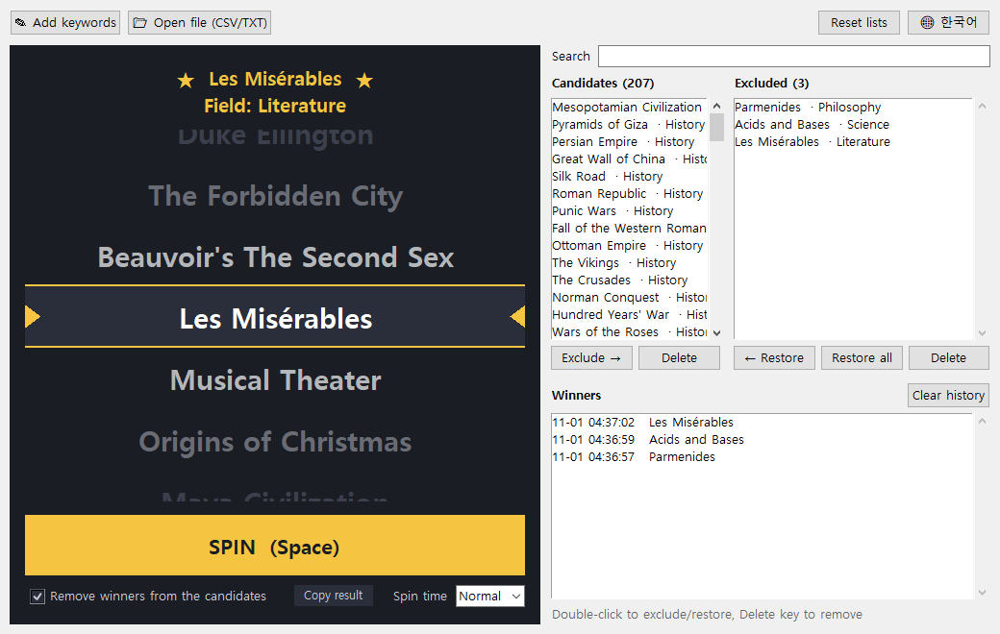
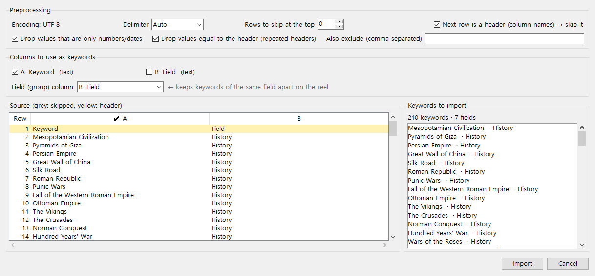

**English** | [한국어](README.ko.md)

# CurioSpin

A slot machine for your curiosity. Load a list of topics, hit **SPIN**, and let the reel pick what you read, study, or talk about next.

CurioSpin is a single portable Windows executable. There is nothing to install, and it uses no AI models or online services. Everything runs locally on plain algorithms.



## Why I made this

I have the Korean edition (*1일 1페이지, 세상에서 가장 짧은 교양 수업 365*) of **_The Intellectual Devotional: Revive Your Mind, Complete Your Education, and Roam Confidently with the Cultured Class_**. It has one short lesson per day across seven fields. Reading it front to back felt like homework, so I wanted to pick the day's topic at random. Rolling dice over 365 page numbers is no fun. I wanted a slot machine that spins through the actual topic names and stops on one.

> CurioSpin is not affiliated with the book or its publishers, and this repository contains none of the book's content. The [sample keyword lists](#sample-keyword-lists) were written to avoid the book's topics. To use the app with a book, make your own list.

## Features

- **Slot machine draw**: the reel spins, slows down, overshoots a little and settles on the winner. You can set the spin time to short, normal or long.
- **Fair**: the winner is chosen uniformly at random with the OS random generator *before* the animation starts. The reel order never changes the odds.
- **Similar topics never sit together**: each spin reshuffles the reel so that similar keywords are kept apart, for example *Mozart's Requiem* and *Wolfgang Amadeus Mozart*. Keywords from the same field are kept apart too. See [how it works](doc/how-it-works.md).
- **Exclude winners, restore mistakes**: winners can be moved to an *Excluded* list automatically. Restore any of them with one click or a double-click.
- **Three ways to add keywords**
  - **Manual input**: a plain text box with no autocomplete. Enter one keyword per line, or separate them with commas.
  - **TXT**: one keyword per line. Lines starting with `#` are comments.
  - **CSV with preprocessing**: title rows, header rows and unrelated columns (IDs, numbers, dates, notes) are detected and dropped automatically. You can review and change every choice in a preview before importing.
- **Field-aware**: if your CSV has a field/category column, CurioSpin uses it to spread the fields out on the reel.
- **English / Korean UI**: switch with the 🌐 button. English is the default.
- **Portable**: your lists, winner history and settings are saved in `keyword_slot_data.json` next to the exe.



## Install

1. Download `CurioSpin.exe` from the [Releases](../../releases) page.
2. Put it in any folder and double-click it. There is no installer and nothing else is needed.

Windows SmartScreen may warn about an *unknown publisher* the first time, because the exe is not code-signed. Click **More info → Run anyway**.

### Build from source

You need Windows, Python 3.12+ with Tkinter, and [uv](https://docs.astral.sh/uv/) (or plain `pip`).

```bat
git clone https://github.com/hobby-programmer-5000/curio-spin.git
cd curio-spin
uv venv --python 3.14 .venv
uv pip install --python .venv\Scripts\python.exe pyinstaller
build.bat
```

`build.bat` runs the tests first and then writes `dist\CurioSpin.exe`. To run the app without building, use `python app.py`.

## Usage

1. **Add keywords**: use **✎ Add keywords**, or **📂 Open file** to load a CSV/TXT file. Try one of the files in [`samples/`](samples).
2. **Spin**: press **SPIN** or the **Space** key.
3. **Manage the lists**
   - Winners move to **Excluded** if *Remove winners from the candidates* is checked.
   - **Exclude →** / **← Restore** (or double-click) move keywords between the lists. **Delete** removes them.
   - **Search** filters both lists by keyword or field.
4. **Language**: the 🌐 button switches between English and Korean.

### CSV import

When you open a CSV, a preview window shows what CurioSpin detected:

| Setting | What it does |
|---|---|
| Rows to skip at the top | Title rows such as "Keyword list 2026" and blank rows |
| Next row is a header | Drops the column-name row |
| Columns to use as keywords | Picked from header names like *Keyword / Topic / Name*. Columns of numbers and dates are left out |
| Field (group) column | A *Field / Category / Genre* column, or a column of short repeated values |
| Filters | Drop number/date-only values, repeated headers, or any words you list |

Encodings: UTF-8 (with or without BOM), UTF-16, and CP949/EUC-KR (Korean Excel). Delimiters: comma, semicolon, tab and pipe are detected automatically.

## Sample keyword lists

[`samples/keywords_en.csv`](samples/keywords_en.csv) and [`samples/keywords_ko.csv`](samples/keywords_ko.csv) each contain the same **210 general-knowledge topics**, 30 in each of seven fields: History, Literature, Art, Science, Music, Philosophy and Religion. The lists were written for this project.

Every topic was checked against the book's topic list so that none of them overlap. The checks looked for exact matches, one name containing another, and the similarity score used by the app. The remaining flagged pairs were reviewed by hand. They only share common words like "music", "theorem" or a first name, and are different topics.

You can rerun the check against any list of your own (the reference file is not part of this repository):

```bat
python tools\check_samples.py my_reference_list.csv
```

## Project layout

```
app.py          Tkinter UI (slot reel, lists, dialogs)
core.py         similarity, reel arrangement, CSV/TXT parsing (standard library only)
i18n.py         English/Korean UI strings
test_core.py    unit tests (python test_core.py)
build.bat       tests + PyInstaller one-file build
samples/        sample keyword lists (EN/KO)
tools/          check_samples.py: overlap check of the samples against a reference list
doc/            how it works (EN/KO), screenshots
```

## Contributors

- [@hobby-programmer-5000](https://github.com/hobby-programmer-5000): idea, requirements, testing
- **Claude** (Anthropic): design and implementation, pair-programmed in [Claude Code](https://claude.com/claude-code)

## License

[MIT](LICENSE). Anyone can use, change and share it.
